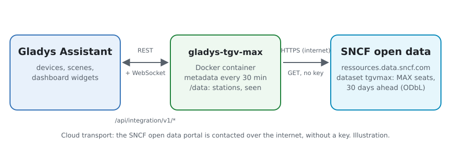
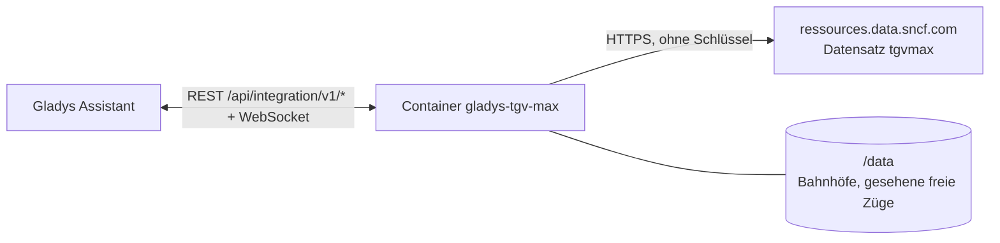
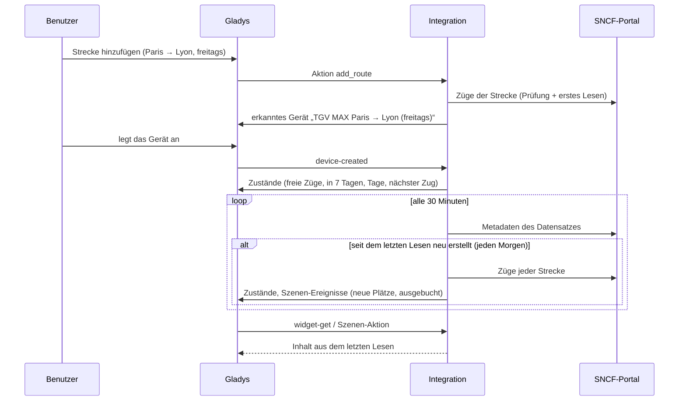
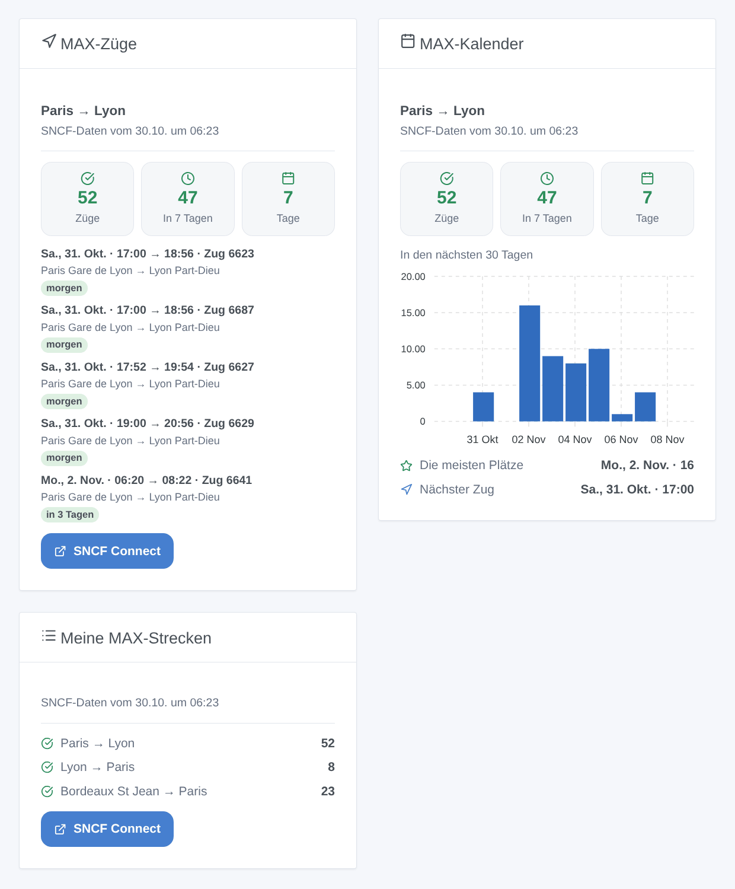

# Gladys TGV MAX

[English](README.md) · [Français](README.fr.md) · **Deutsch** · [Español](README.es.md)

[](LICENSE)
[](https://github.com/William-De71/gladys-tgv-max/releases)
[](https://github.com/William-De71/gladys-tgv-max/actions/workflows/release.yml)
[](https://gladysassistant.com)


Externe Integration für [Gladys Assistant](https://gladysassistant.com) für die Abonnements **MAX JEUNE** und **MAX SENIOR** der SNCF: Verfolgen Sie Ihre Strecken („Paris → Lyon, freitags ab 17 Uhr“) und erfahren Sie, wenn dort MAX-Plätze frei werden, mit Szenen und Dashboard-Widgets. Sie liest die offiziellen Open Data von SNCF Voyageurs, ohne Konto und ohne Schlüssel.

Benutzerdokumentation: [English](docs/en.md) · [Français](docs/fr.md) · [Deutsch](docs/de.md) · [Español](docs/es.md).

> Community-Integration, weder mit der SNCF verbunden noch von ihr unterstützt. MAX JEUNE, MAX SENIOR, TGV INOUI, Intercités und SNCF Connect sind Marken der SNCF.

## Funktionen

- **Ein Gerät pro verfolgter Strecke** (bis zu 20, mit der Schaltfläche **Strecke hinzufügen**, auf Wunsch mit Rückfahrt): Eine Stadt („Paris“, „Lyon“) umfasst alle Bahnhöfe der Stadt, ein Bahnhof („Aix en Provence TGV“) nur sich selbst; gefiltert nach **Tagen** (täglich, Montag bis Freitag, Wochenende, Freitag bis Sonntag, ein Wochentag oder bis zu zehn Daten) und **Abfahrtszeiten**.
- Pro Strecke: die Züge mit freien MAX-Plätzen in den nächsten 30 Tagen, innerhalb von 7 Tagen, die Tage mit Plätzen und der nächste freie Zug.
- **2 Szenen-Auslöser**, **2 Szenen-Aktionen** und **3 Dashboard-Widgets** (unten): „neue MAX-Plätze“ löst jeden Morgen einmal pro Strecke aus, mit den frei gewordenen Zügen.
- Die SNCF erstellt den Datensatz einmal täglich am frühen Morgen neu: Seine Metadaten werden alle 30 Minuten gelesen, die Züge der Strecken nur, wenn er sich geändert hat (eine Anfrage pro Strecke und Tag). Die Bahnhöfe des Datensatzes werden in `/data` gespeichert.
- Konfigurations-Schaltflächen: Verbindung testen, Bahnhof suchen, Strecken hinzufügen / bearbeiten / entfernen / auflisten.
- Vier Sprachen überall: Englisch, Französisch, Deutsch, Spanisch.

## Funktionsweise





Der Datensatz `tgvmax` von SNCF Voyageurs listet alle MAX-Züge der nächsten 30 Tage, ein Eintrag pro Zug und bedientem Bahnhofspaar, mit `od_happy_card` „OUI“, solange MAX-Plätze buchbar sind. Die Integration liest ihn auf dem Opendatasoft-Portal der SNCF (Explore API v2.1), auf dem Portal nach den beiden Bahnhöfen jeder Strecke gefiltert, führt die Einträge eines Zuges zusammen (Paris → Lyon ergibt einen Eintrag nach Part-Dieu und einen nach Perrache), behält die Züge der Tage und Zeiten der Strecke, die noch nicht abgefahren sind, und vergleicht die freien Züge mit denen des Vortags, um die Szenen auszulösen.



### Transport

Nur Cloud (`"transports": ["cloud"]`): Der Katalog zeigt das Cloud-Badge. Die Integration kontaktiert `ressources.data.sncf.com`; nur die Bahnhöfe der verfolgten Strecken werden gesendet. Es gibt keine lokale Alternative, daher keine Schaltfläche „lokale Verbindung bevorzugen“.

## Geräte und Funktionen

| Gerät                      | Funktion                        | Kategorie / Typ              | Werte                                               |
| -------------------------- | ------------------------------- | ---------------------------- | --------------------------------------------------- |
| TGV MAX \<von\> → \<nach\> | Züge mit MAX-Plätzen            | `counter-sensor` / `integer` | 0 … 2000, in den nächsten 30 Tagen                  |
| TGV MAX \<von\> → \<nach\> | Züge mit MAX-Plätzen in 7 Tagen | `counter-sensor` / `integer` | 0 … 2000                                            |
| TGV MAX \<von\> → \<nach\> | Tage mit MAX-Plätzen            | `counter-sensor` / `integer` | 0 … 31                                              |
| TGV MAX \<von\> → \<nach\> | Nächster Zug mit MAX-Plätzen    | `text` / `text`              | „Fr., 6. Nov. · 06:20 → 08:22 · Zug 6641“, „Keiner“ |

Der Gerätename enthält die Tage und Zeiten der Strecke („TGV MAX Paris → Lyon (freitags, 17:00–21:00)“), damit zwei Strecken zwischen denselben Bahnhöfen unterscheidbar bleiben. Seine externe ID ist eine bei der Erstellung vergebene Zufallskennung, nie ein Bahnhofsname: Das Bearbeiten der Tage oder Zeiten behält das Gerät.

## Szenen-Auslöser, Aktionen und Widgets



**Szenen-Auslöser** (das erste Lesen einer Strecke ist eine Referenz und löst nichts aus):

- **Neue MAX-Plätze**: Auf Zügen einer verfolgten Strecke wurden MAX-Plätze frei, die am Vortag keine hatten (oder noch nicht aufgeführt waren: Der Datensatz fügt jeden Morgen einen Tag hinzu, 30 Tage im Voraus). Ein Ereignis pro Strecke und Morgen, mit der Zahl der Züge, dem ersten (Datum, Uhrzeit, Zugnummer, Tage bis zur Abfahrt) und einer Zusammenfassung, die sie auflistet. Filter: Strecke.
- **Keine MAX-Plätze mehr**: Eine verfolgte Strecke hatte freie Züge und hat keine mehr. Filter: Strecke.

**Szenen-Aktionen**: **MAX-Plätze suchen** zwischen zwei beliebigen Bahnhöfen an einem Datum (heute, morgen, 06/11, +3…), in einem Zeitfenster, und **Verfolgte Strecke lesen** (freie Züge, Tage, der nächste, eine Zusammenfassung).

**Widgets**: **MAX-Züge** (die nächsten freien Züge einer Strecke, mit den Bahnhöfen und den Tagen bis zur Abfahrt), **MAX-Kalender** (die freien Züge jedes Tages der Strecke über 30 Tage, als Balken) und **Meine MAX-Strecken** (alle verfolgten Strecken in einer Karte). Jedes zeigt die Uhrzeit der Daten und einen Link zu SNCF Connect.

Beispiele:

- Wenn **neue MAX-Plätze** auf Paris → Lyon (freitags ab 17 Uhr) frei werden → `{{triggerEvent.data.summary}}` an Ihr Telefon senden.
- Wenn **eine Strecke keine MAX-Plätze mehr hat** → die Schreibtischlampe rot schalten.
- Jeden Donnerstag um 8 Uhr → **MAX-Plätze suchen** von Lyon nach Paris für morgen, und wenn `found` wahr ist, die `summary` vom Küchenlautsprecher vorlesen lassen.

## Voraussetzungen

- Gladys Assistant **5.3.0** oder neuer (Widgets und Szenen-Auslöser externer Integrationen, Katalog-Schlüsselwörter und -Länder von Gladys 5.3). Ältere Instanzen können die Integration nicht installieren.
- Ein MAX-JEUNE- oder MAX-SENIOR-Abonnement, um die Plätze zu buchen (auf SNCF Connect). Sonst nichts: Die Open Data der SNCF brauchen weder Konto noch Schlüssel.

## Installation

- **Aus dem Store** von Gladys (Integrationen → Externe Integrationen), mit einem Klick, sobald indexiert.
- **Über die Repository-URL**: `https://github.com/William-De71/gladys-tgv-max`.
- **Entwicklermodus**: Bauen Sie das Image lokal (`docker build -t gladys-tgv-max .`) und installieren Sie es aus Gladys.

## Konfiguration

| Feld / Schaltfläche | Beschreibung                                                                                                                                        |
| ------------------- | --------------------------------------------------------------------------------------------------------------------------------------------------- |
| Sprache der Texte   | Gerätenamen, nächster Zug und Szenen-Zusammenfassungen. Automatisch: die Sprache des Dashboards (Französisch, solange kein Widget angezeigt wurde). |
| Strecke hinzufügen  | Abfahrts- und Ankunftsbahnhof, Tage, Daten (ersetzen die Tage), Abfahrtszeiten (ab / vor) und „auch die Rückfahrt verfolgen“.                       |
| Strecke bearbeiten  | Die Tage, Daten oder Zeiten einer Strecke, über ihre Nummer oder ihre Bahnhöfe: Das Gerät bleibt. Andere Bahnhöfe ergeben eine andere Strecke.      |
| Strecke entfernen   | Über ihre Nummer in **Strecken auflisten** oder ihre Bahnhöfe („paris lyon“).                                                                       |
| Bahnhof suchen      | Die MAX-Bahnhöfe, die einige Wörter enthalten, die meistbefahrenen zuerst: „marseille“ ergibt Marseille St Charles und Marseille Blancarde.         |
| Verbindung testen   | Das Datum der Daten, die Zahl der Bahnhöfe und die heute verbleibenden Anfragen.                                                                    |

Die Strecken werden in der Gladys-Konfiguration gespeichert und folgen so ihren Sicherungen.

## Nutzung

1. Drücken Sie **Strecke hinzufügen**: „Paris“, „Lyon“, freitags, von 17 bis 21, und auf Wunsch die Rückfahrt.
2. Legen Sie im Tab **Erkennung** die Geräte „TGV MAX …“ an.
3. Fügen Sie die Widgets **MAX-Züge**, **MAX-Kalender** und **Meine MAX-Strecken** einem Dashboard hinzu und erstellen Sie eine Szene mit **Neue MAX-Plätze**.

## Entwicklung

```bash
npm install
npm test                       # node --test, berührt nie das Netzwerk
npm run lint && npm run format:check
npx github:GladysAssistant/integration-store . --skip-image-check
scripts/build-cover.sh         # cover.jpg aus docs/assets/cover.svg
docs/illustrations/render.sh   # docs/assets/widgets.<Sprache>.png
node .github/scripts/release.mjs next
```

Lokal liest das SDK `GLADYS_HOST_API_URL`, `GLADYS_INTEGRATION_TOKEN` und `GLADYS_INTEGRATION_SELECTOR`; `SNCF_API_URL` lenkt die Integration auf eine andere Datensatz-Wurzel (ein Mock); `DEBUG=gladys-integration-sdk` zeigt die SDK-Logs und prüft jeden Widget-Inhalt. Die Tests verwenden echte, gekürzte Antworten des SNCF-Portals (`test/fixtures/`, ODbL). Die Regeln des Projekts stehen in [CLAUDE.md](CLAUDE.md).

## Release-Prozess


Jeder Merge auf `main` startet die CI und berechnet dann die Version aus den [Conventional Commits](https://www.conventionalcommits.org/de/) seit dem letzten Tag: `feat` → Minor, `fix` / `perf` → Patch, `!` oder `BREAKING CHANGE` → Major (ein Minor unter 1.0.0); `docs`, `chore`, `ci`, `test`, `style`, `refactor`, `build` allein veröffentlichen nichts. Der Changelog-Abschnitt wird erzeugt, der Tag gepusht, das Multi-Architektur-Image gebaut, dann erhält `main` den Release-Commit, die GitHub Release wird erstellt und ein letzter Job prüft das öffentliche Image, den Store-Validator und das Topic.

- Der Titel des Pull Requests wird zum Squash-Commit und dann zur Changelog-Zeile: Schreiben Sie ihn auf Englisch, für den Benutzer (`pr-title.yml` prüft ihn). Bearbeiten Sie `CHANGELOG.md` nie von Hand.
- 1.0.0 ist eine Entscheidung: Actions → Release → Run workflow mit `release-as: 1.0.0`. `dry-run` zeigt Version und Notizen, ohne zu veröffentlichen.
- **Geschützter Branch**: Die Release pusht ihren Commit mit `GITHUB_TOKEN` auf `main`. Mit einem Ruleset auf `main`, das strenger ist als „kein Löschen, kein Force-Push“, fügen Sie GitHub Actions zur Bypass-Liste hinzu (oder pushen über eine GitHub App), sonst schlägt der Veröffentlichungs-Job mit Anweisungen fehl.
- Machen Sie nach der ersten Release das `ghcr.io`-Paket öffentlich (Package settings → Change visibility), sonst kann Gladys es nicht herunterladen.

## Fehlerbehebung

Siehe [docs/de.md](docs/de.md#fehlerbehebung). Melden Sie Probleme mit den Versionen von Gladys und der Integration, der betroffenen Strecke und den Antworten von **Verbindung testen** und **Strecken auflisten**.

## Mitwirken

Issues und Pull Requests sind willkommen. Führen Sie `npm run format:check && npm run lint && npm test` aus, bevor Sie einen Pull Request öffnen, und lassen Sie jede externe ID und jeden gespeicherten Schlüssel unverändert (siehe [CLAUDE.md](CLAUDE.md)).

## Sicherheit

Siehe [SECURITY.md](SECURITY.md): Melden Sie Schwachstellen vertraulich. Die Integration braucht kein Geheimnis: Sie liest nur öffentliche Open Data und läuft schreibgeschützt, als Nicht-Root-Benutzer, in ihrem Container.

## Kommende Screenshots

Die Bilder oben sind Illustrationen, keine Screenshots. Echte Screenshots kommen in `docs/assets/screenshots/` (PNG, 1280 × 800): `configuration.png`, `discovery.png`, `device.png`, `scene.png`.

## Lizenz

[Apache License 2.0](LICENSE) — siehe auch [NOTICE](NOTICE). Die Züge und die MAX-Plätze sind Open Data von SNCF Voyageurs (Datensatz „Disponibilité à 30 jours de places MAX JEUNE et MAX SENIOR ouvertes à la réservation“) unter der [ODbL](https://opendatacommons.org/licenses/odbl/1-0/): Die Widgets zeigen die Quelle und die Uhrzeit der Daten. Danke an die Dokumentation und das SDK von Gladys und an die SNCF für die Öffnung dieses Datensatzes.
