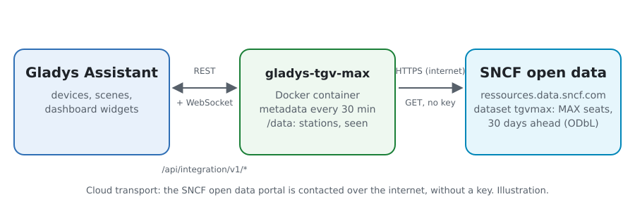
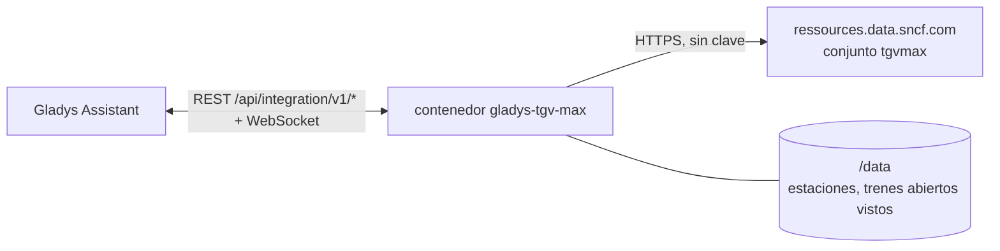
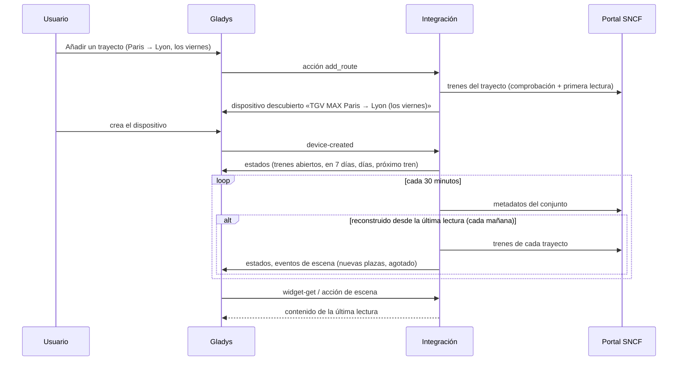
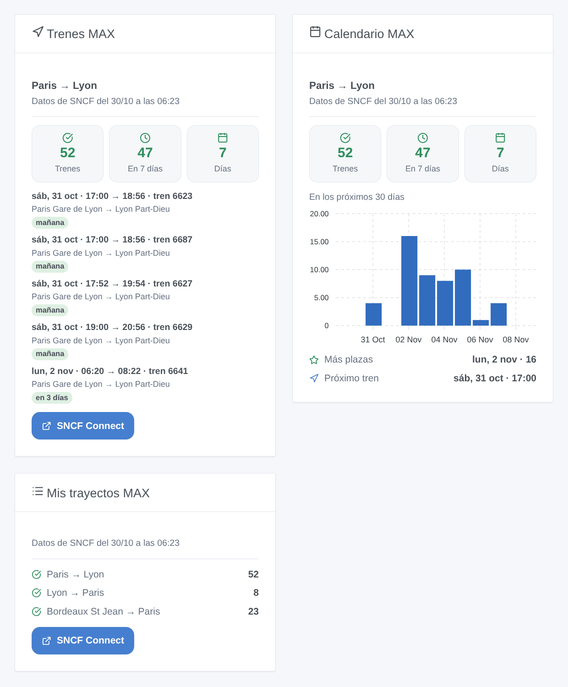

# Gladys TGV MAX

[English](README.md) · [Français](README.fr.md) · [Deutsch](README.de.md) · **Español**

[](LICENSE)
[](https://github.com/William-De71/gladys-tgv-max/releases)
[](https://github.com/William-De71/gladys-tgv-max/actions/workflows/release.yml)
[](https://gladysassistant.com)


Integración externa de [Gladys Assistant](https://gladysassistant.com) para los abonos **MAX JEUNE** y **MAX SENIOR** de SNCF: siga sus trayectos («Paris → Lyon, los viernes desde las 17:00») y reciba un aviso cuando se abran plazas MAX, con escenas y widgets para el panel. Lee los datos abiertos oficiales de SNCF Voyageurs, sin cuenta ni clave.

Documentación de usuario: [English](docs/en.md) · [Français](docs/fr.md) · [Deutsch](docs/de.md) · [Español](docs/es.md).

> Integración comunitaria, no afiliada ni respaldada por SNCF. MAX JEUNE, MAX SENIOR, TGV INOUI, Intercités y SNCF Connect son marcas de SNCF.

## Funciones

- **Un dispositivo por trayecto seguido** (hasta 20, añadidos con el botón **Añadir un trayecto**, con la vuelta de una vez): una ciudad («Paris», «Lyon») abarca todas sus estaciones, una estación («Aix en Provence TGV») solo a sí misma; filtrado por **días** (todos los días, de lunes a viernes, fines de semana, de viernes a domingo, un día de la semana o hasta diez fechas) y **horas de salida**.
- Por trayecto: los trenes con plazas MAX abiertas en los próximos 30 días, en 7 días, los días con plazas y el próximo tren abierto.
- **2 disparadores de escena**, **2 acciones de escena** y **3 widgets** (abajo): «nuevas plazas MAX» se dispara una vez por trayecto cada mañana, con los trenes que se abrieron.
- SNCF reconstruye el conjunto de datos una vez al día, temprano por la mañana: sus metadatos se leen cada 30 minutos, los trenes de los trayectos solo cuando ha cambiado (una petición por trayecto y día). Las estaciones del conjunto se guardan en `/data`.
- Botones de configuración: probar la conexión, buscar una estación, añadir / modificar / eliminar / listar trayectos.
- Cuatro idiomas en todas partes: inglés, francés, alemán, español.

## Funcionamiento





El conjunto `tgvmax` de SNCF Voyageurs enumera todos los trenes MAX de los próximos 30 días, un registro por tren y por par de estaciones servidas, con `od_happy_card` a «OUI» mientras haya plazas MAX abiertas a la reserva. La integración lo lee en el portal Opendatasoft de SNCF (Explore API v2.1), filtrado en el portal por las dos estaciones de cada trayecto, fusiona los registros de un mismo tren (Paris → Lyon da un registro hacia Part-Dieu y otro hacia Perrache), conserva los trenes de los días y horas del trayecto que aún no han salido, y compara los trenes abiertos con los del día anterior para disparar las escenas.



### Transporte

Solo en la nube (`"transports": ["cloud"]`): el catálogo muestra la insignia de nube. La integración contacta con `ressources.data.sncf.com`; solo se envían las estaciones de los trayectos seguidos. No existe alternativa local, así que no hay botón «preferir la conexión local».

## Dispositivos y funciones

| Dispositivo                      | Función                         | Categoría / tipo             | Valores                                             |
| -------------------------------- | ------------------------------- | ---------------------------- | --------------------------------------------------- |
| TGV MAX \<salida\> → \<llegada\> | Trenes con plazas MAX           | `counter-sensor` / `integer` | 0 … 2000, en los próximos 30 días                   |
| TGV MAX \<salida\> → \<llegada\> | Trenes con plazas MAX en 7 días | `counter-sensor` / `integer` | 0 … 2000                                            |
| TGV MAX \<salida\> → \<llegada\> | Días con plazas MAX             | `counter-sensor` / `integer` | 0 … 31                                              |
| TGV MAX \<salida\> → \<llegada\> | Próximo tren con plazas MAX     | `text` / `text`              | «vie, 6 nov · 06:20 → 08:22 · tren 6641», «Ninguno» |

El nombre del dispositivo incluye los días y las horas del trayecto («TGV MAX Paris → Lyon (los viernes, 17:00–21:00)»), para que dos trayectos entre las mismas estaciones se distingan. Su identificador externo es un identificador aleatorio asignado al crearlo, nunca un nombre de estación: modificar los días o las horas conserva el dispositivo.

## Disparadores, acciones de escena y widgets



**Disparadores de escena** (la primera lectura de un trayecto es una referencia y no dispara nada):

- **Nuevas plazas MAX**: se abrieron plazas MAX en trenes de un trayecto seguido que no tenían la víspera (o que aún no figuraban: el conjunto añade un día cada mañana, a 30 días). Un evento por trayecto y por mañana, con el número de trenes, el primero (fecha, hora, número de tren, días hasta la salida) y un resumen que los enumera. Filtro: trayecto.
- **Sin plazas MAX**: un trayecto seguido tenía trenes abiertos y ya no le queda ninguno. Filtro: trayecto.

**Acciones de escena**: **Buscar plazas MAX** entre dos estaciones en una fecha (hoy, mañana, 06/11, +3…), en una franja horaria, y **Leer un trayecto seguido** (trenes abiertos, días, el próximo, un resumen).

**Widgets**: **Trenes MAX** (los próximos trenes abiertos de un trayecto, con las estaciones y los días hasta la salida), **Calendario MAX** (los trenes abiertos de cada día del trayecto durante 30 días, en barras) y **Mis trayectos MAX** (todos los trayectos seguidos en una tarjeta). Cada uno muestra la hora de los datos y un enlace a SNCF Connect.

Ejemplos:

- Cuando se abran **nuevas plazas MAX** en Paris → Lyon (los viernes desde las 17:00) → enviar `{{triggerEvent.data.summary}}` a su teléfono.
- Cuando **un trayecto se quede sin plazas MAX** → encender la lámpara del escritorio en rojo.
- Cada jueves a las 8:00 → **buscar plazas MAX** de Lyon a Paris para mañana y, si `found` es verdadero, hacer que el altavoz de la cocina lea el `summary`.

## Requisitos

- Gladys Assistant **5.3.0** o posterior (widgets y disparadores de las integraciones externas, palabras clave y países del catálogo de Gladys 5.3). Las instancias más antiguas no pueden instalar la integración.
- Un abono MAX JEUNE o MAX SENIOR para reservar las plazas (en SNCF Connect). Nada más: los datos abiertos de SNCF no requieren cuenta ni clave.

## Instalación

- **Desde la tienda** de Gladys (Integraciones → Integraciones externas), en un clic, una vez indexada.
- **Desde la URL del repositorio**: `https://github.com/William-De71/gladys-tgv-max`.
- **Modo desarrollador**: construya la imagen en local (`docker build -t gladys-tgv-max .`) e instálela desde Gladys.

## Configuración

| Campo / botón         | Descripción                                                                                                                                       |
| --------------------- | ------------------------------------------------------------------------------------------------------------------------------------------------- |
| Idioma de los textos  | Nombres de los dispositivos, próximo tren y resúmenes de escenas. Automático: el idioma del panel (francés mientras no se muestre ningún widget). |
| Añadir un trayecto    | Estación de salida y de llegada, días, fechas (sustituyen a los días), horas de salida (desde / antes de) y «seguir también la vuelta».           |
| Modificar un trayecto | Los días, fechas u horas de un trayecto, por su número o sus estaciones: el dispositivo se mantiene. Otras estaciones forman otro trayecto.       |
| Eliminar un trayecto  | Por su número en **Listar los trayectos**, o sus estaciones («paris lyon»).                                                                       |
| Buscar una estación   | Las estaciones MAX que contienen algunas palabras, las más concurridas primero: «marseille» da Marseille St Charles y Marseille Blancarde.        |
| Probar la conexión    | La fecha de los datos, el número de estaciones y las peticiones que quedan hoy.                                                                   |

Los trayectos se guardan en la configuración de Gladys, por lo que siguen sus copias de seguridad.

## Uso

1. Pulse **Añadir un trayecto**: «Paris», «Lyon», los viernes, de 17 a 21, y la vuelta si lo desea.
2. En la pestaña **Descubrimiento**, cree los dispositivos «TGV MAX …».
3. Añada los widgets **Trenes MAX**, **Calendario MAX** y **Mis trayectos MAX** a un panel, y cree una escena con **Nuevas plazas MAX**.

## Desarrollo

```bash
npm install
npm test                       # node --test, nunca toca la red
npm run lint && npm run format:check
npx github:GladysAssistant/integration-store . --skip-image-check
scripts/build-cover.sh         # cover.jpg desde docs/assets/cover.svg
docs/illustrations/render.sh   # docs/assets/widgets.<idioma>.png
node .github/scripts/release.mjs next
```

En local, el SDK lee `GLADYS_HOST_API_URL`, `GLADYS_INTEGRATION_TOKEN` y `GLADYS_INTEGRATION_SELECTOR`; `SNCF_API_URL` dirige la integración a otra raíz de conjuntos de datos (una maqueta); `DEBUG=gladys-integration-sdk` muestra los registros del SDK y comprueba cada contenido de widget. Las pruebas usan respuestas reales del portal de SNCF, reducidas (`test/fixtures/`, ODbL). Las reglas del proyecto están en [CLAUDE.md](CLAUDE.md).

## Proceso de publicación


Cada fusión en `main` ejecuta la CI y luego calcula la versión a partir de los [Conventional Commits](https://www.conventionalcommits.org/es/) desde la última etiqueta: `feat` → menor, `fix` / `perf` → parche, `!` o `BREAKING CHANGE` → mayor (una menor por debajo de 1.0.0); `docs`, `chore`, `ci`, `test`, `style`, `refactor`, `build` solos no publican nada. Se genera la sección del changelog, se sube la etiqueta, se construye la imagen multiarquitectura, luego `main` recibe el commit de publicación, se crea la GitHub Release y un último job comprueba la imagen pública, el validador de la tienda y el topic.

- El título de la pull request se convierte en el commit de squash y luego en la línea del changelog: escríbalo en inglés, para el usuario (`pr-title.yml` lo comprueba). No edite nunca `CHANGELOG.md` a mano.
- La 1.0.0 es una decisión: Actions → Release → Run workflow con `release-as: 1.0.0`. `dry-run` muestra la versión y las notas sin publicar.
- **Rama protegida**: la publicación sube su commit a `main` con `GITHUB_TOKEN`. Con un ruleset en `main` más estricto que «sin borrado ni force-push», añada GitHub Actions a su lista de excepciones (o suba mediante una GitHub App); si no, el job de publicación falla con instrucciones.
- Tras la primera publicación, haga público el paquete de `ghcr.io` (Package settings → Change visibility), o Gladys no podrá descargarlo.

## Solución de problemas

Vea [docs/es.md](docs/es.md#solución-de-problemas). Informe de los problemas con las versiones de Gladys y de la integración, el trayecto afectado y las respuestas de **Probar la conexión** y **Listar los trayectos**.

## Contribuir

Las issues y pull requests son bienvenidas. Ejecute `npm run format:check && npm run lint && npm test` antes de abrir una pull request, y no cambie ningún identificador externo ni ninguna clave guardada (vea [CLAUDE.md](CLAUDE.md)).

## Seguridad

Vea [SECURITY.md](SECURITY.md): informe de las vulnerabilidades en privado. La integración no necesita ningún secreto: solo lee datos abiertos públicos y se ejecuta en solo lectura, como usuario no root, en su contenedor.

## Capturas pendientes

Las imágenes anteriores son ilustraciones, no capturas de pantalla. Las capturas reales irán en `docs/assets/screenshots/` (PNG, 1280 × 800): `configuration.png`, `discovery.png`, `device.png`, `scene.png`.

## Licencia

[Licencia Apache 2.0](LICENSE) — vea también [NOTICE](NOTICE). Los trenes y las plazas MAX son datos abiertos de SNCF Voyageurs (conjunto «Disponibilité à 30 jours de places MAX JEUNE et MAX SENIOR ouvertes à la réservation») con licencia [ODbL](https://opendatacommons.org/licenses/odbl/1-0/): los widgets muestran la fuente y la hora de los datos. Gracias a la documentación y al SDK de Gladys, y a SNCF por abrir este conjunto de datos.
