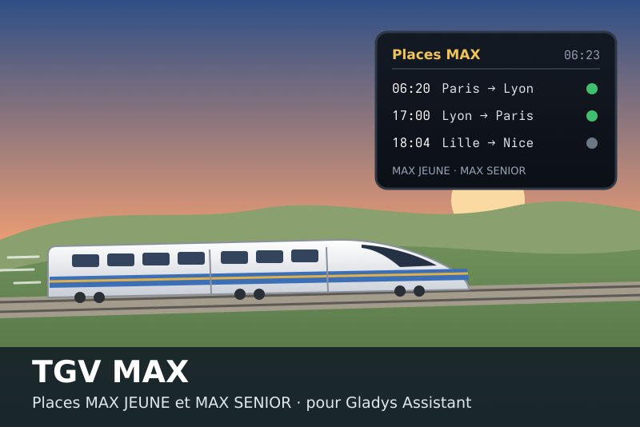
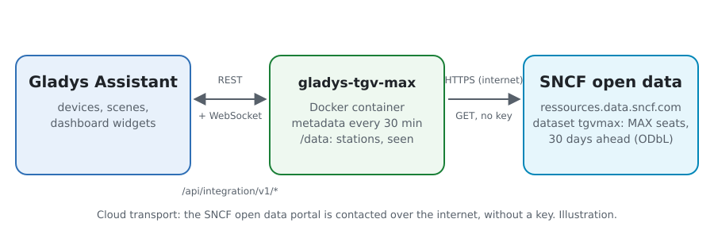
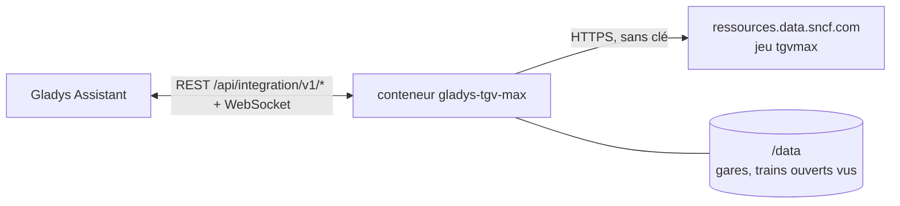
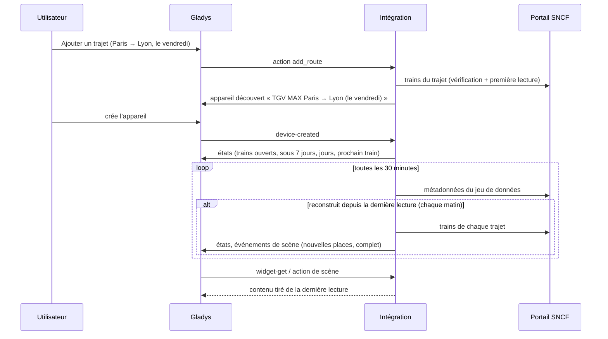
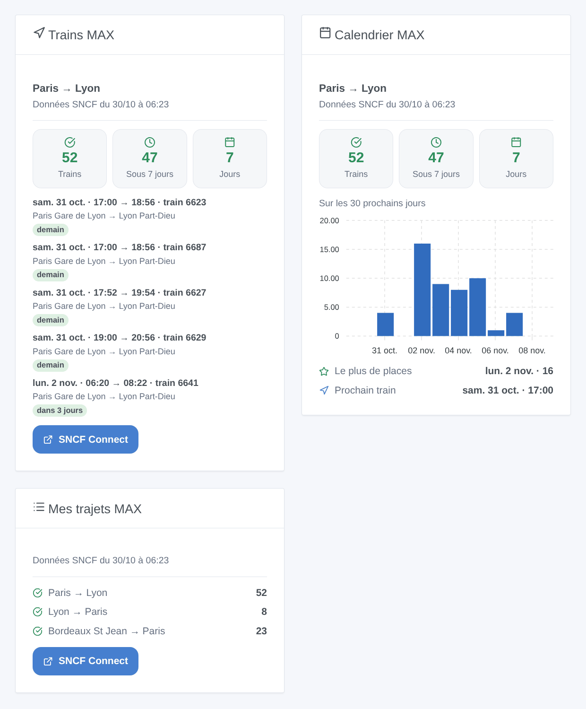

# Gladys TGV MAX

[English](README.md) · **Français** · [Deutsch](README.de.md) · [Español](README.es.md)

[](LICENSE)
[](https://github.com/William-De71/gladys-tgv-max/releases)
[](https://github.com/William-De71/gladys-tgv-max/actions/workflows/release.yml)
[](https://gladysassistant.com)



Intégration externe de [Gladys Assistant](https://gladysassistant.com) pour les abonnements **MAX JEUNE** et **MAX SENIOR** de SNCF : suivez vos trajets (« Paris → Lyon, le vendredi à partir de 17 h ») et soyez prévenu quand des places MAX s’y ouvrent, avec des scènes et des widgets pour le tableau de bord. Elle lit l’open data officiel de SNCF Voyageurs, sans compte ni clé.

Documentation utilisateur : [English](docs/en.md) · [Français](docs/fr.md) · [Deutsch](docs/de.md) · [Español](docs/es.md).

> Intégration communautaire, ni affiliée ni approuvée par SNCF. MAX JEUNE, MAX SENIOR, TGV INOUI, Intercités et SNCF Connect sont des marques de SNCF.

## Fonctionnalités

- **Un appareil par trajet suivi** (jusqu’à 20, ajoutés avec le bouton **Ajouter un trajet**, le retour d’un seul coup) : une ville (« Paris », « Lyon ») couvre toutes les gares de la ville, une gare (« Aix en Provence TGV ») seulement elle-même ; filtré par **jours** (tous les jours, du lundi au vendredi, le week-end, du vendredi au dimanche, un jour de la semaine, ou jusqu’à dix dates) et **heures de départ**.
- Par trajet : les trains avec des places MAX ouvertes sur les 30 prochains jours, sous 7 jours, les jours avec des places et le prochain train ouvert.
- **2 déclencheurs de scène**, **2 actions de scène** et **3 widgets** (ci-dessous) : « nouvelles places MAX » se déclenche une fois par trajet chaque matin, avec les trains qui se sont ouverts.
- SNCF reconstruit le jeu de données une fois par jour, tôt le matin : ses métadonnées sont lues toutes les 30 minutes, les trains des trajets seulement quand il a changé (une requête par trajet et par jour). Les gares du jeu de données sont gardées dans `/data`.
- Boutons de configuration : tester la connexion, chercher une gare, ajouter / modifier / supprimer / lister les trajets.
- Quatre langues partout : anglais, français, allemand, espagnol.

## Fonctionnement





Le jeu `tgvmax` de SNCF Voyageurs liste tous les trains MAX des 30 prochains jours, une ligne par train et par couple de gares desservies, avec `od_happy_card` à « OUI » tant que des places MAX sont ouvertes à la réservation. L’intégration le lit sur le portail Opendatasoft de SNCF (Explore API v2.1), filtré sur le portail par les deux gares de chaque trajet, fusionne les lignes d’un même train (Paris → Lyon donne une ligne vers Part-Dieu et une vers Perrache), garde les trains des jours et des heures du trajet qui ne sont pas encore partis, et compare les trains ouverts à ceux de la veille pour déclencher les scènes.



### Transport

Cloud uniquement (`"transports": ["cloud"]`) : le catalogue affiche le badge cloud. L’intégration contacte `ressources.data.sncf.com` ; seules les gares des trajets suivis sont envoyées. Il n’existe pas d’alternative locale, donc pas de bouton « préférer la connexion locale ».

## Appareils et fonctionnalités

| Appareil                         | Fonctionnalité                      | Catégorie / type             | Valeurs                                                 |
| -------------------------------- | ----------------------------------- | ---------------------------- | ------------------------------------------------------- |
| TGV MAX \<départ\> → \<arrivée\> | Trains avec places MAX              | `counter-sensor` / `integer` | 0 … 2000, sur les 30 prochains jours                    |
| TGV MAX \<départ\> → \<arrivée\> | Trains avec places MAX sous 7 jours | `counter-sensor` / `integer` | 0 … 2000                                                |
| TGV MAX \<départ\> → \<arrivée\> | Jours avec places MAX               | `counter-sensor` / `integer` | 0 … 31                                                  |
| TGV MAX \<départ\> → \<arrivée\> | Prochain train avec places MAX      | `text` / `text`              | « ven. 6 nov. · 06:20 → 08:22 · train 6641 », « Aucun » |

Le nom de l’appareil contient les jours et les heures du trajet (« TGV MAX Paris → Lyon (le vendredi, 17:00–21:00) ») : deux trajets entre les mêmes gares restent distincts. Son identifiant externe est un identifiant aléatoire donné à la création, jamais un nom de gare : modifier les jours ou les heures garde l’appareil.

## Déclencheurs, actions de scène et widgets



**Déclencheurs de scène** (la première lecture d’un trajet sert de référence et ne déclenche rien) :

- **Nouvelles places MAX** : des places MAX se sont ouvertes sur des trains d’un trajet suivi qui n’en avaient pas la veille (ou qui n’étaient pas encore listés : le jeu de données ajoute un jour chaque matin, à 30 jours). Un événement par trajet et par matin, avec le nombre de trains, le premier (date, heure, numéro, jours avant le départ) et un résumé qui les liste. Filtre : trajet.
- **Plus de places MAX** : un trajet suivi avait des trains ouverts et n’en a plus. Filtre : trajet.

**Actions de scène** : **Chercher des places MAX** entre deux gares à une date (aujourd’hui, demain, 06/11, +3…), dans une plage d’heures, et **Lire un trajet suivi** (trains ouverts, jours, le prochain, un résumé).

**Widgets** : **Trains MAX** (les prochains trains ouverts d’un trajet, avec les gares et le délai avant le départ), **Calendrier MAX** (les trains ouverts de chaque jour du trajet sur 30 jours, en barres) et **Mes trajets MAX** (tous les trajets suivis dans une carte). Chacun affiche l’heure des données et un lien vers SNCF Connect.

Exemples :

- Quand **de nouvelles places MAX** s’ouvrent sur Paris → Lyon (le vendredi à partir de 17 h) → envoyer `{{triggerEvent.data.summary}}` sur votre téléphone.
- Quand **un trajet n’a plus de places MAX** → allumer la lampe du bureau en rouge.
- Chaque jeudi à 8 h → **chercher des places MAX** de Lyon à Paris pour demain, et si `found` est vrai, faire dire le `summary` par l’enceinte de la cuisine.

## Prérequis

- Gladys Assistant **5.3.0** ou plus récent (widgets et déclencheurs des intégrations externes, mots-clés et pays du catalogue de Gladys 5.3). Les instances plus anciennes ne peuvent pas installer l’intégration.
- Un abonnement MAX JEUNE ou MAX SENIOR pour réserver les places (sur SNCF Connect). Rien d’autre : l’open data SNCF ne demande ni compte ni clé.

## Installation

- **Depuis le store** de Gladys (Intégrations → Intégrations externes), en un clic, une fois indexée.
- **Depuis l’URL du dépôt** : `https://github.com/William-De71/gladys-tgv-max`.
- **Mode développeur** : construisez l’image en local (`docker build -t gladys-tgv-max .`) et installez-la depuis Gladys.

## Configuration

| Champ / bouton      | Description                                                                                                                                            |
| ------------------- | ------------------------------------------------------------------------------------------------------------------------------------------------------ |
| Langue des textes   | Noms des appareils, prochain train et résumés des scènes. Automatique : la langue du tableau de bord (le français tant qu’aucun widget n’est affiché). |
| Ajouter un trajet   | Gare de départ et d’arrivée, jours, dates (remplacent les jours), heures de départ (à partir de / avant), et « suivre aussi le retour ».               |
| Modifier un trajet  | Les jours, les dates ou les heures d’un trajet, par son numéro ou ses gares : l’appareil reste. D’autres gares font un autre trajet.                   |
| Supprimer un trajet | Par son numéro dans **Lister les trajets**, ou ses gares (« paris lyon »).                                                                             |
| Chercher une gare   | Les gares MAX qui contiennent quelques mots, les plus fréquentées d’abord : « marseille » donne Marseille St Charles et Marseille Blancarde.           |
| Tester la connexion | La date des données, le nombre de gares et les requêtes restantes aujourd’hui.                                                                         |

Les trajets sont gardés dans la configuration de Gladys : ils suivent ses sauvegardes.

## Utilisation

1. Appuyez sur **Ajouter un trajet** : « Paris », « Lyon », le vendredi, de 17 à 21, et le retour si vous le souhaitez.
2. Dans l’onglet **Découverte**, créez les appareils « TGV MAX … ».
3. Ajoutez les widgets **Trains MAX**, **Calendrier MAX** et **Mes trajets MAX** à un tableau de bord, et créez une scène sur **Nouvelles places MAX**.

## Développement

```bash
npm install
npm test                       # node --test, ne touche jamais le réseau
npm run lint && npm run format:check
npx github:GladysAssistant/integration-store . --skip-image-check
scripts/build-cover.sh         # cover.jpg depuis docs/assets/cover.svg
docs/illustrations/render.sh   # docs/assets/widgets.<langue>.png
node .github/scripts/release.mjs next
```

En local, le SDK lit `GLADYS_HOST_API_URL`, `GLADYS_INTEGRATION_TOKEN` et `GLADYS_INTEGRATION_SELECTOR` ; `SNCF_API_URL` fait pointer l’intégration vers une autre racine de jeux de données (une maquette) ; `DEBUG=gladys-integration-sdk` affiche les journaux du SDK et vérifie chaque contenu de widget. Les tests utilisent de vraies réponses du portail SNCF, réduites (`test/fixtures/`, ODbL). Les règles du projet sont dans [CLAUDE.md](CLAUDE.md).

## Processus de release


Chaque fusion sur `main` lance la CI, puis calcule la version depuis les [Conventional Commits](https://www.conventionalcommits.org/fr/) depuis le dernier tag : `feat` → mineure, `fix` / `perf` → correctif, `!` ou `BREAKING CHANGE` → majeure (une mineure sous 1.0.0) ; `docs`, `chore`, `ci`, `test`, `style`, `refactor`, `build` seuls ne publient rien. La section du changelog est générée, le tag poussé, l’image multi-architecture construite, puis `main` reçoit le commit de release, la GitHub Release est créée et un dernier job vérifie l’image publique, le validateur du store et le topic.

- Le titre de la pull request devient le commit de squash, puis la ligne du changelog : écrivez-le en anglais, pour l’utilisateur (`pr-title.yml` le vérifie). Ne modifiez jamais `CHANGELOG.md` à la main.
- La 1.0.0 est une décision : Actions → Release → Run workflow avec `release-as: 1.0.0`. `dry-run` affiche la version et les notes sans rien publier.
- **Branche protégée** : la release pousse son commit sur `main` avec `GITHUB_TOKEN`. Avec un ruleset sur `main` plus strict que « ni suppression ni force-push », ajoutez GitHub Actions à sa liste de contournement (ou poussez via une GitHub App), sinon le job de publication échoue avec des instructions.
- Après la première release, rendez le package `ghcr.io` public (Package settings → Change visibility), sinon Gladys ne peut pas le télécharger.

## Dépannage

Voir [docs/fr.md](docs/fr.md#dépannage). Signalez les problèmes avec les versions de Gladys et de l’intégration, le trajet concerné et les réponses de **Tester la connexion** et **Lister les trajets**.

## Contribuer

Les issues et pull requests sont les bienvenues. Lancez `npm run format:check && npm run lint && npm test` avant d’ouvrir une pull request, et ne changez aucun identifiant externe ni aucune clé stockée (voir [CLAUDE.md](CLAUDE.md)).

## Sécurité

Voir [SECURITY.md](SECURITY.md) : signalez les vulnérabilités en privé. L’intégration n’a besoin d’aucun secret : elle ne lit que des données ouvertes publiques, et tourne en lecture seule, en utilisateur non root, dans son conteneur.

## Captures à venir

Les images ci-dessus sont des illustrations, pas des captures d’écran. Les vraies captures iront dans `docs/assets/screenshots/` (PNG, 1280 × 800) : `configuration.png`, `discovery.png`, `device.png`, `scene.png`.

## Licence

[Licence Apache 2.0](LICENSE) — voir aussi [NOTICE](NOTICE). Les trains et les places MAX sont des données ouvertes de SNCF Voyageurs (jeu « Disponibilité à 30 jours de places MAX JEUNE et MAX SENIOR ouvertes à la réservation ») sous [ODbL](https://opendatacommons.org/licenses/odbl/1-0/) : les widgets affichent la source et l’heure des données. Merci à la documentation et au SDK de Gladys, et à SNCF d’avoir ouvert ce jeu de données.
