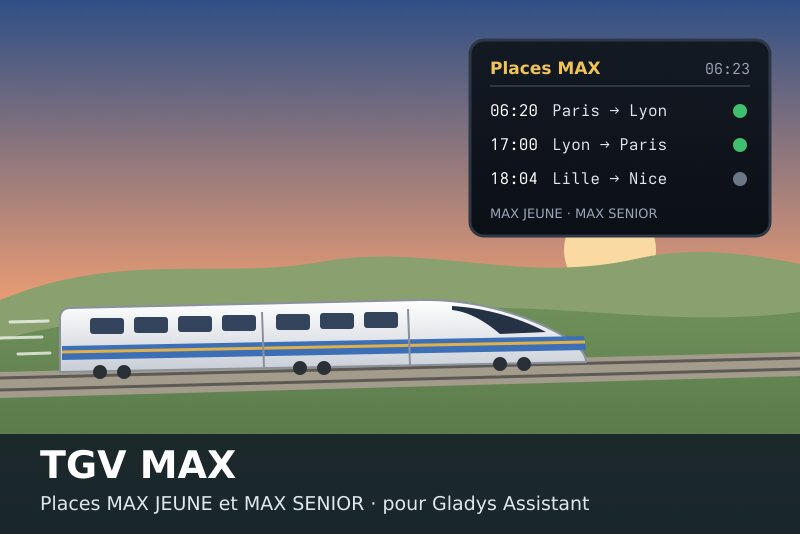
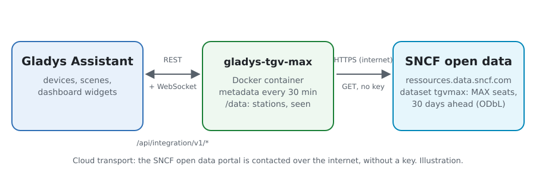
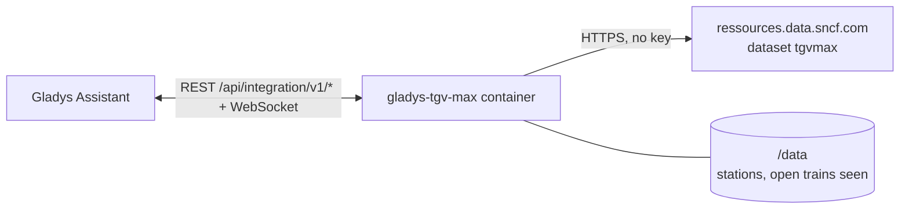
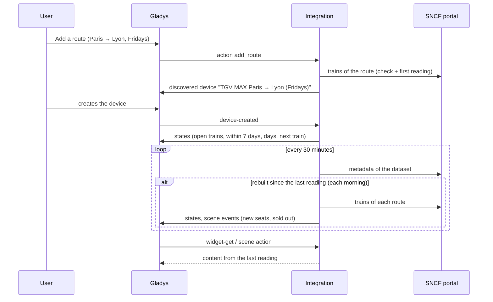
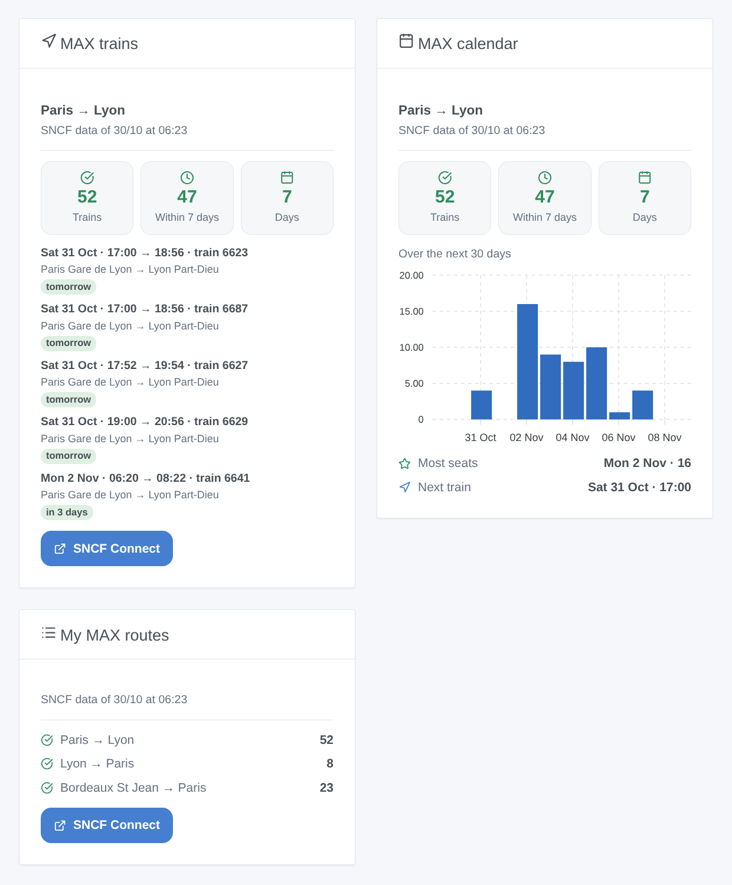

# Gladys TGV MAX

**English** · [Français](README.fr.md) · [Deutsch](README.de.md) · [Español](README.es.md)

[](LICENSE)
[](https://github.com/William-De71/gladys-tgv-max/releases)
[](https://github.com/William-De71/gladys-tgv-max/actions/workflows/release.yml)
[](https://gladysassistant.com)



[Gladys Assistant](https://gladysassistant.com) external integration for the **MAX JEUNE** and **MAX SENIOR** subscriptions of SNCF: follow your routes ("Paris → Lyon, Fridays from 17:00") and get told when MAX seats open on them, with scenes and dashboard widgets. It reads the official open data of SNCF Voyageurs, without an account or a key.

User documentation: [English](docs/en.md) · [Français](docs/fr.md) · [Deutsch](docs/de.md) · [Español](docs/es.md).

> Community integration, not affiliated with nor endorsed by SNCF. MAX JEUNE, MAX SENIOR, TGV INOUI, Intercités and SNCF Connect are trademarks of SNCF.

## Features

- **One device per followed route** (up to 20, added with the **Add a route** button, the return trip in one go): a city ("Paris", "Lyon") covers every station of the city, a station ("Aix en Provence TGV") only itself; filtered by **days** (every day, weekdays, weekends, Friday to Sunday, one day of the week, or up to ten dates) and **departure hours**.
- Per route: the trains with MAX seats open over the next 30 days, within 7 days, the days with seats, and the next open train.
- **2 scene triggers**, **2 scene actions** and **3 dashboard widgets** (below): "new MAX seats" fires once per route each morning with the trains that opened.
- The dataset is rebuilt by SNCF once a day, early in the morning: its metadata is read every 30 minutes, the trains of the routes only when it changed (one request per route and per day). The stations of the dataset are kept in `/data`.
- Configuration buttons: test the connection, find a station, add / edit / remove / list routes.
- Four languages everywhere: English, French, German, Spanish.

## How it works





The dataset `tgvmax` of SNCF Voyageurs lists every MAX train over the next 30 days, one record per train and per pair of stations it serves, with `od_happy_card` "OUI" while MAX seats are open for booking. The integration reads it on the Opendatasoft portal of SNCF (Explore API v2.1), filtered on the portal by the two stations of each route, merges the records of one train (Paris → Lyon gives one record to Part-Dieu and one to Perrache), keeps the trains of the days and hours of the route that have not left yet, and compares the open trains with the ones of the previous morning to fire the scene triggers.



### Transport

Cloud only (`"transports": ["cloud"]`): the catalog shows the cloud badge. The integration contacts `ressources.data.sncf.com`; only the stations of the followed routes are sent. There is no local alternative, so there is no "prefer the local connection" button.

## Devices and features

| Device                    | Feature                             | Category / type              | Values                                           |
| ------------------------- | ----------------------------------- | ---------------------------- | ------------------------------------------------ |
| TGV MAX \<from\> → \<to\> | Trains with MAX seats               | `counter-sensor` / `integer` | 0 … 2000, over the next 30 days                  |
| TGV MAX \<from\> → \<to\> | Trains with MAX seats within 7 days | `counter-sensor` / `integer` | 0 … 2000                                         |
| TGV MAX \<from\> → \<to\> | Days with MAX seats                 | `counter-sensor` / `integer` | 0 … 31                                           |
| TGV MAX \<from\> → \<to\> | Next train with MAX seats           | `text` / `text`              | "Fri 6 Nov · 06:20 → 08:22 · train 6641", "None" |

The device name holds the days and hours of the route ("TGV MAX Paris → Lyon (Fridays, 17:00–21:00)"), so two routes between the same stations stay apart. Its external id is a random identifier given at creation, never a station name: editing the days or the hours keeps the device.

## Scene triggers, actions and widgets



**Scene triggers** (the first reading of a route is a reference and fires nothing):

- **New MAX seats**: MAX seats opened on trains of a followed route that had none the day before (or were not listed yet: the dataset adds a new day every morning, 30 days ahead). One event per route and per morning, with the number of trains, the first one (date, time, train number, days until it) and a summary listing them. Filter: route.
- **No more MAX seats**: a followed route had open trains and has none left. Filter: route.

**Scene actions**: **Search MAX seats** between any two stations on a date (today, tomorrow, 06/11, +3…), within some hours, and **Read a followed route** (open trains, days, the next one, a summary).

**Widgets**: **MAX trains** (the next open trains of a route, with the stations and how many days until them), **MAX calendar** (the open trains of each day of the route over 30 days, in bars) and **My MAX routes** (every followed route in one card). Each shows the time of the data and links to SNCF Connect.

Examples:

- When **new MAX seats** open on Paris → Lyon (Fridays from 17:00) → send `{{triggerEvent.data.summary}}` to your phone.
- When **a route has no more MAX seats** → light the desk lamp in red.
- Every Thursday at 8:00 → **search MAX seats** from Lyon to Paris for tomorrow, and if `found` is true, have the `summary` spoken by the kitchen speaker.

## Requirements

- Gladys Assistant **5.3.0** or later (widgets and scene triggers of external integrations, catalog keywords and countries of Gladys 5.3). Older instances cannot install the integration.
- A MAX JEUNE or MAX SENIOR subscription to book the seats (on SNCF Connect). Nothing else: the open data of SNCF need neither an account nor a key.

## Installation

- **From the store** of Gladys (Integrations → External integrations), in one click, once indexed.
- **From the repository URL**: `https://github.com/William-De71/gladys-tgv-max`.
- **Developer mode**: build the image locally (`docker build -t gladys-tgv-max .`) and install it from Gladys.

## Configuration

| Field / button        | Description                                                                                                                        |
| --------------------- | ---------------------------------------------------------------------------------------------------------------------------------- |
| Language of the texts | Device names, the next train and scene summaries. Automatic: the language of the dashboard (French until a widget is shown).       |
| Add a route           | Departure and arrival station, days, dates (replace the days), departure hours (from / before), and "also follow the return trip". |
| Edit a route          | The days, dates or hours of a route, by its number or its stations: the device stays. Other stations make another route.           |
| Remove a route        | By its number in **List the routes**, or its stations ("paris lyon").                                                              |
| Find a station        | The stations of MAX holding some words, the busiest first: "marseille" gives Marseille St Charles and Marseille Blancarde.         |
| Test the connection   | The date of the data, the number of stations, and the requests left today.                                                         |

The routes are kept in the Gladys configuration, so they follow its backups.

## Usage

1. Press **Add a route**: "Paris", "Lyon", Fridays, from 17 to 21, and the return trip if you wish.
2. In the **Discover** tab, create the "TGV MAX …" devices.
3. Add the **MAX trains**, **MAX calendar** and **My MAX routes** widgets to a dashboard, and build a scene on **New MAX seats**.

## Development

```bash
npm install
npm test                       # node --test, never touches the network
npm run lint && npm run format:check
npx github:GladysAssistant/integration-store . --skip-image-check
scripts/build-cover.sh         # cover.jpg from docs/assets/cover.svg
docs/illustrations/render.sh   # docs/assets/widgets.<lang>.png
node .github/scripts/release.mjs next
```

Locally, the SDK reads `GLADYS_HOST_API_URL`, `GLADYS_INTEGRATION_TOKEN` and `GLADYS_INTEGRATION_SELECTOR`; `SNCF_API_URL` points the integration to another datasets root (a mock); `DEBUG=gladys-integration-sdk` shows the SDK logs and checks every widget content. The tests use real answers of the SNCF portal, reduced (`test/fixtures/`, ODbL). The rules of the project are in [CLAUDE.md](CLAUDE.md).

## Release process


Every merge on `main` runs the CI, then computes the version from the [Conventional Commits](https://www.conventionalcommits.org/) since the last tag: `feat` → minor, `fix` / `perf` → patch, `!` or `BREAKING CHANGE` → major (a minor below 1.0.0); `docs`, `chore`, `ci`, `test`, `style`, `refactor`, `build` alone publish nothing. The changelog section is generated, the tag pushed, the multi-architecture image built, then `main` receives the release commit, the GitHub Release is created and a last job checks the public image, the store validator and the topic.

- The pull request title becomes the squash commit, then the changelog line: write it in English, for the user (`pr-title.yml` checks it). Never edit `CHANGELOG.md` by hand.
- 1.0.0 is a decision: Actions → Release → Run workflow with `release-as: 1.0.0`. `dry-run` shows the version and the notes without publishing.
- **Protected branch**: the release pushes its commit to `main` with `GITHUB_TOKEN`. With a ruleset on `main` stricter than "no deletion, no force-push", add GitHub Actions to its bypass list (or push through a GitHub App), otherwise the publish job fails with instructions.
- After the first release, make the `ghcr.io` package public (Package settings → Change visibility), or Gladys cannot pull it.

## Troubleshooting

See [docs/en.md](docs/en.md#troubleshooting). Report issues with the versions of Gladys and of the integration, the route concerned, and the answers of **Test the connection** and **List the routes**.

## Contributing

Issues and pull requests are welcome. Run `npm run format:check && npm run lint && npm test` before opening a pull request, and keep every external id and stored key unchanged (see [CLAUDE.md](CLAUDE.md)).

## Security

See [SECURITY.md](SECURITY.md): report vulnerabilities privately. The integration needs no secret: it only reads public open data, and runs read-only, as a non-root user, in its container.

## Screenshots to come

The images above are illustrations, not screenshots. Real screenshots will go in `docs/assets/screenshots/` (PNG, 1280 × 800): `configuration.png`, `discovery.png`, `device.png`, `scene.png`.

## License

[Apache License 2.0](LICENSE) — see also [NOTICE](NOTICE). The trains and the MAX seats are open data of SNCF Voyageurs (dataset "Disponibilité à 30 jours de places MAX JEUNE et MAX SENIOR ouvertes à la réservation") under the [ODbL](https://opendatacommons.org/licenses/odbl/1-0/): the widgets show the source and the time of the data. Thanks to the Gladys documentation and SDK, and to SNCF for opening this dataset.
