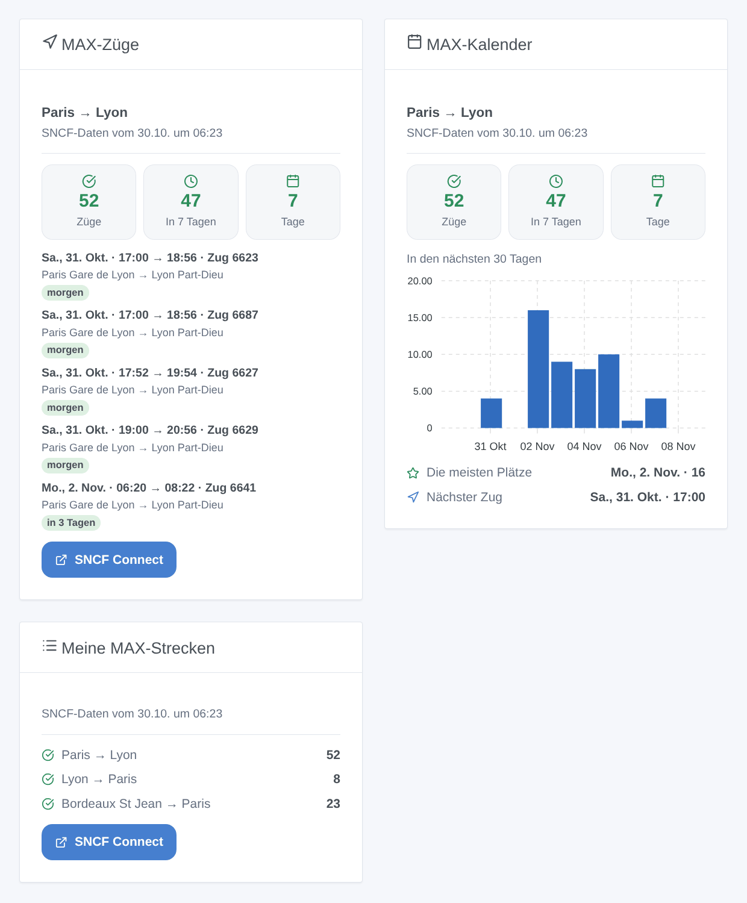

# TGV MAX

## Überblick

Diese Integration verfolgt die **MAX-JEUNE**- (16-27 Jahre) und **MAX-SENIOR**-Plätze (ab 60) der SNCF, der unbegrenzten Abonnements für TGV INOUI und reservierungspflichtige Intercités. Sie legen Ihre Strecken fest — „Paris → Lyon, freitags ab 17 Uhr“, „Lyon → Paris, sonntags“ — und jede wird zu einem Gerät: die Züge mit freien MAX-Plätzen in den nächsten 30 Tagen, innerhalb von 7 Tagen, die Tage mit Plätzen und der nächste freie Zug. Ein Szenen-Auslöser meldet jeden Morgen, wenn auf einer Strecke MAX-Plätze frei werden, und drei Widgets zeigen die Züge, einen 30-Tage-Kalender und alle Ihre Strecken.

Die Daten stammen aus den **offiziellen Open Data von SNCF Voyageurs** (Datensatz „Disponibilité à 30 jours de places MAX JEUNE et MAX SENIOR ouvertes à la réservation“), unter der ODbL-Lizenz: kein Konto, kein Schlüssel. Die SNCF erstellt ihn **einmal täglich am frühen Morgen** neu: Die Integration prüft alle 30 Minuten, ob er sich geändert hat, und liest dann die Züge Ihrer Strecken. Die angezeigten Plätze sind also die vom Morgen: Manche sind im Laufe des Tages weg, andere kommen zurück. Buchen Sie immer auf SNCF Connect, wo die Plätze live sind.

Es ist eine **Cloud**-Integration: Sie kontaktiert `ressources.data.sncf.com`. Nichts anderes verlässt Ihr Netzwerk.

## Voraussetzungen

- Gladys Assistant 5.3.0 oder neuer.
- Ein MAX-JEUNE- oder MAX-SENIOR-Abonnement, um die Plätze auf SNCF Connect zu buchen. Sonst nichts: Die Open Data der SNCF brauchen weder Konto noch Schlüssel.

## Konfiguration

| Feld / Schaltfläche | Funktion                                                                                                                                                      |
| ------------------- | ------------------------------------------------------------------------------------------------------------------------------------------------------------- |
| Strecke hinzufügen  | Abfahrts- und Ankunftsbahnhof, die Tage, die Daten (sie ersetzen die Tage), die Abfahrtszeiten und „auch die Rückfahrt verfolgen“ (zwei Strecken auf einmal). |
| Strecke bearbeiten  | Ändert die Tage, Daten oder Zeiten einer Strecke (ihre Nummer in **Strecken auflisten** oder ihre Bahnhöfe): Das Gerät bleibt.                                |
| Strecke entfernen   | Beendet die Verfolgung einer Strecke. Löschen Sie auch ihr Gerät in Gladys, wenn Sie es nicht mehr brauchen.                                                  |
| Strecken auflisten  | Alle verfolgten Strecken, nummeriert, mit ihren Zügen mit MAX-Plätzen.                                                                                        |
| Bahnhof suchen      | Die MAX-Bahnhöfe, die einige Wörter enthalten: „marseille“ ergibt Marseille St Charles und Marseille Blancarde.                                               |
| Verbindung testen   | Das Datum der Daten, die Zahl der Bahnhöfe und die heute verbleibenden Anfragen.                                                                              |
| Sprache der Texte   | Gerätenamen, nächster Zug und Szenen-Zusammenfassungen. Automatisch: die Sprache des Dashboards (Französisch, solange kein Widget angezeigt wurde).           |

**Bahnhöfe.** Geben Sie eine Stadt oder einen Bahnhof so ein, wie die SNCF ihn nennt. „Paris“, „Lyon“ und „Lille“ umfassen alle Bahnhöfe der Stadt: Paris → Lyon verfolgt jeden Zug von einem beliebigen Pariser Bahnhof nach Part-Dieu oder Perrache. Ein einzelner Bahnhof: „Lyon St Exupery“, „Aix en Provence TGV“, „Marne la Vallee“. Kann ein Name mehrere Bahnhöfe bezeichnen („Marseille“, „Avignon“, „Valence“), listet die Integration sie auf: Geben Sie den gewünschten ein. Ausländische Bahnhöfe funktionieren auf Französisch oder in ihrer Sprache („Barcelone“, „Genf“, „Basel“).

**Tage und Zeiten.** Täglich, Montag bis Freitag, am Wochenende, Freitag bis Sonntag oder ein Wochentag; oder bis zu zehn Daten (06/11, 08/11/2026, +3), die die Tage ersetzen. Die Zeiten sind Abfahrtszeiten: „ab 17“ und „vor 21“ behalten die Züge, die von 17:00 bis 20:59 abfahren. Beim Hinzufügen prüft die Integration, dass MAX-Züge zwischen den beiden Bahnhöfen fahren.

Die Strecken werden in der Gladys-Konfiguration gespeichert und folgen so ihren Sicherungen. Bis zu 20 Strecken.

## Nutzung

### Geräte

Legen Sie im Tab **Erkennung** die Geräte **TGV MAX \<von\> → \<nach\>** an. Jedes hat vier Funktionen:

- **Züge mit MAX-Plätzen**: die Züge der Strecke mit freien MAX-Plätzen in den nächsten 30 Tagen;
- **Züge mit MAX-Plätzen in 7 Tagen**;
- **Tage mit MAX-Plätzen**: die Daten mit mindestens einem freien Zug;
- **Nächster Zug mit MAX-Plätzen**: „Sa., 31. Okt. · 07:00 → 08:56 · Zug 6603“ oder „Keiner“.

Ein Zug, der heute abgefahren ist, zählt nicht mehr, auch wenn die Daten vom Morgen ihn noch aufführen.

### Dashboard-Widgets

- **MAX-Züge**: drei Kacheln (freie Züge, in 7 Tagen, Tage), dann die nächsten freien Züge mit ihren Bahnhöfen („Paris Gare de Lyon → Lyon Part-Dieu“) und der Zeit bis zur Abfahrt, die Uhrzeit der Daten und eine Schaltfläche zu SNCF Connect. Die Einstellung **Angezeigte Züge** legt die Länge der Liste fest.
- **MAX-Kalender**: die freien Züge jedes Tages der Strecke über 30 Tage als Balken, der Tag mit den meisten Plätzen und der nächste Zug.
- **Meine MAX-Strecken**: alle verfolgten Strecken in einer Karte, mit ihrer Zahl freier Züge oder „Keiner“.

### Szenen

Auslöser (das erste Lesen einer Strecke dient nur als Referenz):

- **TGV MAX: neue MAX-Plätze**: Auf Zügen einer verfolgten Strecke, die am Vortag keine hatten, oder an einem neuen Tag des Datensatzes (er fügt jeden Morgen einen hinzu, 30 Tage im Voraus) wurden MAX-Plätze frei. Ein Ereignis pro Strecke und Morgen, auch wenn zehn Züge frei werden: `{{triggerEvent.data.summary}}` listet sie auf, `count` gibt ihre Zahl, `first_date_text`, `first_departure`, `first_train` und `days_until` beschreiben den ersten.
- **TGV MAX: keine MAX-Plätze mehr**: Eine verfolgte Strecke hatte freie Züge und hat keine mehr.

Aktionen:

- **TGV MAX: MAX-Plätze suchen**: die Züge mit MAX-Plätzen zwischen zwei Bahnhöfen an einem Datum (heute, morgen, 06/11, +3; innerhalb von 30 Tagen), in einem Zeitfenster. Ausgaben: `found`, `count`, der erste Zug, eine `summary`. Es muss keine Strecke verfolgt werden.
- **TGV MAX: verfolgte Strecke lesen**: ihre freien Züge, ihre Tage mit Plätzen, der nächste Zug und eine `summary`.

Beispiele:

- Wenn auf Paris → Lyon (freitags ab 17 Uhr) neue MAX-Plätze frei werden → die Zusammenfassung an Ihr Telefon senden.
- Wenn eine Strecke keine MAX-Plätze mehr hat → die Schreibtischlampe rot schalten.
- Jeden Donnerstag um 8 Uhr → MAX-Plätze von Lyon nach Paris für morgen suchen; wenn `found` wahr ist, die Zusammenfassung vom Küchenlautsprecher vorlesen lassen.

### Transport

Nur Cloud: Die Daten kommen aus dem Internet. Nur die Bahnhöfe Ihrer Strecken werden an das Portal der SNCF gesendet.

## Fehlerbehebung

- **„Kein MAX-Bahnhof heißt …“**: Nutzen Sie **Bahnhof suchen** und geben Sie den Anfang des Städtenamens ein. MAX gilt nur für TGV INOUI und reservierungspflichtige Intercités: Bahnhöfe von TER und OUIGO sind nicht aufgeführt.
- **„Kein MAX-Zug fährt von … nach …“**: Kein MAX-Zug verbindet diese beiden Bahnhöfe in den nächsten 30 Tagen. Versuchen Sie die Stadt („Paris“) statt eines Bahnhofs oder den anderen Bahnhof der Stadt.
- **Die angezeigten Plätze sind auf SNCF Connect weg**: Die Daten stammen vom Morgen, und die Plätze sind schnell vergeben. Die Widgets zeigen die Uhrzeit der Daten.
- **Am ersten Tag löst nichts aus**: Das erste Lesen einer Strecke ist eine Referenz; der Auslöser greift ab dem nächsten Morgen, wenn Plätze frei werden.
- **„Tageskontingent aufgebraucht“**: zu viele Anfragen heute von Ihrer Internetadresse (andere Software kann sie teilen); das Lesen geht nach Mitternacht (UTC) weiter.
- **„Das SNCF-Open-Data-Portal antwortet nicht“**: Die Integration versucht es alle 30 Minuten erneut; die letzten Züge bleiben in den Widgets.
- **Ein Problem melden**: Kopieren Sie die Antworten von **Verbindung testen** und **Strecken auflisten** in ein GitHub-Issue oder eine Antwort im Forum, mit den Versionen von Gladys und der Integration.
