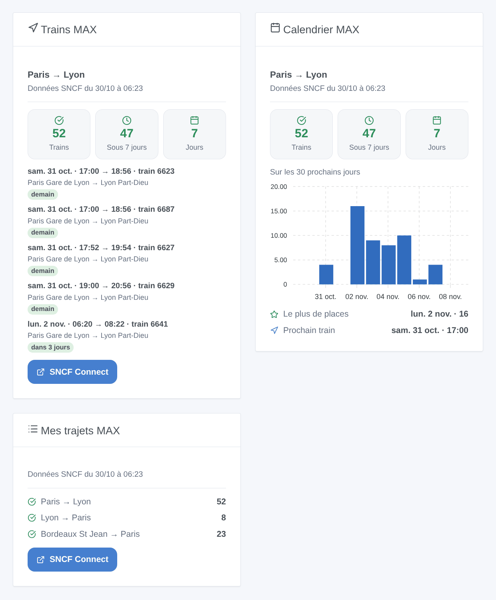

# TGV MAX

## Présentation

Cette intégration suit les places **MAX JEUNE** (16-27 ans) et **MAX SENIOR** (60 ans et plus) de SNCF, les abonnements illimités sur les TGV INOUI et les Intercités à réservation. Vous déclarez vos trajets — « Paris → Lyon, le vendredi à partir de 17 h », « Lyon → Paris, le dimanche » — et chacun devient un appareil : les trains avec des places MAX ouvertes sur les 30 prochains jours, sous 7 jours, les jours avec des places et le prochain train ouvert. Un déclencheur de scène vous prévient chaque matin quand des places MAX s’ouvrent sur un trajet, et trois widgets affichent les trains, un calendrier sur 30 jours et tous vos trajets.

Les données viennent de l’**open data officiel de SNCF Voyageurs** (jeu « Disponibilité à 30 jours de places MAX JEUNE et MAX SENIOR ouvertes à la réservation »), sous licence ODbL : ni compte ni clé. SNCF le reconstruit **une fois par jour, tôt le matin** : l’intégration vérifie toutes les 30 minutes s’il a changé, puis lit les trains de vos trajets. Les places affichées sont donc celles du matin : certaines partent dans la journée, d’autres reviennent. Réservez toujours sur SNCF Connect, où les places sont en direct.

C’est une intégration **cloud** : elle contacte `ressources.data.sncf.com`. Rien d’autre ne quitte votre réseau.

## Prérequis

- Gladys Assistant 5.3.0 ou plus récent.
- Un abonnement MAX JEUNE ou MAX SENIOR, pour réserver les places sur SNCF Connect. Rien d’autre : l’open data SNCF ne demande ni compte ni clé.

## Configuration

| Champ / bouton      | Rôle                                                                                                                                                          |
| ------------------- | ------------------------------------------------------------------------------------------------------------------------------------------------------------- |
| Ajouter un trajet   | Gare de départ et d’arrivée, les jours, les dates (elles remplacent les jours), les heures de départ, et « suivre aussi le retour » (deux trajets d’un coup). |
| Modifier un trajet  | Change les jours, les dates ou les heures d’un trajet (son numéro dans **Lister les trajets**, ou ses gares) : l’appareil reste.                              |
| Supprimer un trajet | Arrête de suivre un trajet. Supprimez aussi son appareil dans Gladys si vous n’en avez plus besoin.                                                           |
| Lister les trajets  | Tous les trajets suivis, numérotés, avec leurs trains avec places MAX.                                                                                        |
| Chercher une gare   | Les gares MAX qui contiennent quelques mots : « marseille » donne Marseille St Charles et Marseille Blancarde.                                                |
| Tester la connexion | La date des données, le nombre de gares et les requêtes restantes aujourd’hui.                                                                                |
| Langue des textes   | Noms des appareils, prochain train et résumés des scènes. Automatique : la langue du tableau de bord (le français tant qu’aucun widget n’est affiché).        |

**Gares.** Tapez une ville ou une gare comme SNCF la nomme. « Paris », « Lyon » et « Lille » couvrent toutes les gares de la ville : Paris → Lyon suit tous les trains de n’importe quelle gare parisienne vers Part-Dieu ou Perrache. Une gare seule : « Lyon St Exupery », « Aix en Provence TGV », « Marne la Vallee ». Quand un nom peut désigner plusieurs gares (« Marseille », « Avignon », « Valence »), l’intégration les liste : tapez celle que vous voulez. Les gares étrangères marchent en français ou dans leur langue (« Barcelone », « Genève », « Bâle »).

**Jours et heures.** Tous les jours, du lundi au vendredi, le week-end, du vendredi au dimanche, ou un jour de la semaine ; ou jusqu’à dix dates (06/11, 08/11/2026, +3), qui remplacent les jours. Les heures sont celles du départ : « à partir de 17 » et « avant 21 » gardent les trains qui partent de 17 h 00 à 20 h 59. À l’ajout du trajet, l’intégration vérifie que des trains MAX circulent entre les deux gares.

Les trajets sont gardés dans la configuration de Gladys : ils suivent ses sauvegardes. Jusqu’à 20 trajets.

## Utilisation

### Appareils

Dans l’onglet **Découverte**, créez les appareils **TGV MAX \<départ\> → \<arrivée\>**. Chacun a quatre fonctionnalités :

- **Trains avec places MAX** : les trains du trajet avec des places MAX ouvertes, sur les 30 prochains jours ;
- **Trains avec places MAX sous 7 jours** ;
- **Jours avec places MAX** : les dates avec au moins un train ouvert ;
- **Prochain train avec places MAX** : « sam. 31 oct. · 07:00 → 08:56 · train 6603 », ou « Aucun ».

Un train parti aujourd’hui n’est plus compté, même si les données du matin le listent encore.

### Widgets du tableau de bord

- **Trains MAX** : trois tuiles (trains ouverts, sous 7 jours, jours), puis les prochains trains ouverts avec leurs gares (« Paris Gare de Lyon → Lyon Part-Dieu ») et le délai avant le départ, l’heure des données et un bouton vers SNCF Connect. Le réglage **Trains affichés** fixe la longueur de la liste.
- **Calendrier MAX** : les trains ouverts de chaque jour du trajet sur 30 jours, en barres, le jour avec le plus de places et le prochain train.
- **Mes trajets MAX** : tous les trajets suivis dans une carte, avec leur nombre de trains ouverts, ou « Aucun ».

### Scènes

Déclencheurs (la première lecture d’un trajet ne sert que de référence) :

- **TGV MAX : nouvelles places MAX** : des places MAX se sont ouvertes sur des trains d’un trajet suivi qui n’en avaient pas la veille, ou sur un nouveau jour du jeu de données (il en ajoute un chaque matin, à 30 jours). Un seul événement par trajet et par matin, même quand dix trains s’ouvrent : `{{triggerEvent.data.summary}}` les liste, `count` donne leur nombre, `first_date_text`, `first_departure`, `first_train` et `days_until` décrivent le premier.
- **TGV MAX : plus de places MAX** : un trajet suivi avait des trains ouverts et n’en a plus.

Actions :

- **TGV MAX : chercher des places MAX** : les trains avec places MAX entre deux gares à une date (aujourd’hui, demain, 06/11, +3 ; dans les 30 jours), dans une plage d’heures. Sorties : `found`, `count`, le premier train, un `summary`. Aucun trajet n’a besoin d’être suivi.
- **TGV MAX : lire un trajet suivi** : ses trains ouverts, ses jours avec places, le prochain train et un `summary`.

Exemples :

- Quand de nouvelles places MAX s’ouvrent sur Paris → Lyon (le vendredi à partir de 17 h) → envoyer le résumé sur votre téléphone.
- Quand un trajet n’a plus de places MAX → allumer la lampe du bureau en rouge.
- Chaque jeudi à 8 h → chercher des places MAX de Lyon à Paris pour demain ; si `found` est vrai, faire dire le résumé par l’enceinte de la cuisine.

### Transport

Cloud uniquement : les données viennent d’internet. Seules les gares de vos trajets sont envoyées au portail de SNCF.

## Dépannage

- **« Aucune gare MAX ne s’appelle … »** : utilisez **Chercher une gare** et tapez le début du nom de la ville. MAX ne couvre que les TGV INOUI et les Intercités à réservation : les gares des TER et des OUIGO n’y sont pas.
- **« Aucun train MAX ne va de … à … »** : aucun train MAX ne relie ces deux gares sur les 30 prochains jours. Essayez la ville (« Paris ») plutôt qu’une gare, ou l’autre gare de la ville.
- **Les places affichées ont disparu sur SNCF Connect** : les données datent du matin et les places partent vite. Les widgets affichent l’heure des données.
- **Rien ne se déclenche le premier jour** : la première lecture d’un trajet sert de référence ; le déclencheur fonctionne dès le matin suivant, quand des places s’ouvrent.
- **« Quota quotidien épuisé »** : trop de requêtes aujourd’hui depuis votre adresse internet (d’autres logiciels peuvent la partager) ; les lectures reprennent après minuit (UTC).
- **« Le portail open data SNCF ne répond pas »** : l’intégration réessaie toutes les 30 minutes ; les derniers trains restent sur les widgets.
- **Pour signaler un problème** : copiez les réponses de **Tester la connexion** et **Lister les trajets** dans une issue GitHub ou une réponse sur le forum, avec les versions de Gladys et de l’intégration.
